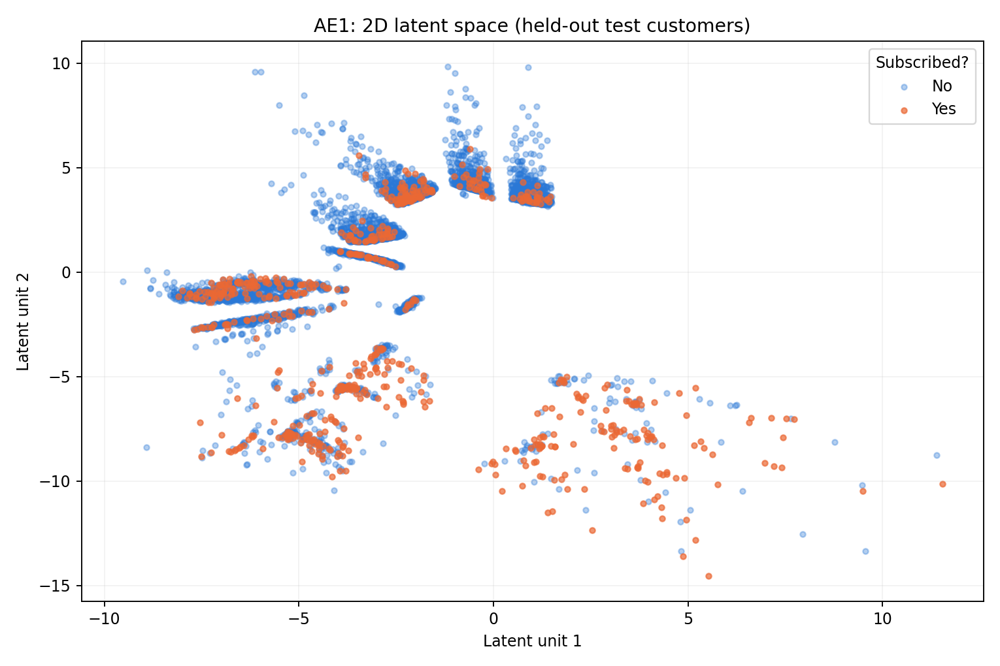

# Customer Response Prediction — UCI Bank Marketing

Predict whether a bank customer will subscribe to a term deposit (`y`), using the [UCI Bank Marketing](https://archive.ics.uci.edu/dataset/222/bank+marketing) dataset (`bank-additional-full.csv`, ≈11% "yes").

## Repo Structure

```
customer-churn-prediction/
├── Bank_Marketing_EDA_Preprocessing.ipynb
├── data/
│   └── bank_clean.csv
└── src/
    ├── preprocess.py
    └── evaluate.py
```

| File | Purpose |
|---|---|
| `Bank_Marketing_EDA_Preprocessing.ipynb` | Loads the raw data, explores and cleans it, and saves `bank_clean.csv` |
| `data/bank_clean.csv` | Cleaned dataset used by every model (`duration` removed to avoid leakage) |
| `src/preprocess.py` | Shared train / validation / test split and model inputs, fitted on train only |
| `src/evaluate.py` | Shared evaluation: checks scores against the split and compares all models |

## Model Plan

| # | Role | Description | Notebook |
|---|---|---|---|
| 1 | ANN Regularization | Same network trained with no regularization, then L2, Dropout, BatchNorm and Early Stopping, to compare their effect | Pending |
| 2 | ANN Entity Embeddings | Multi-input ANN with one Embedding layer per categorical column | Pending |
| 3 | ANN Tuning & Class Imbalance | Keras Tuner search; class weights vs. focal loss | Pending |
| 4 | Denoising Autoencoder + Classifier | Denoising autoencoder, frozen classifier, fine-tuning and a separate 2D bottleneck | [AE1_Learned_Features.ipynb](AE1_Learned_Features.ipynb) |
| 5 | Autoencoder Anomaly Detection | Trained on "no" customers only; reconstruction error is the score | Pending |

## Workflow

1. **Load the shared split** from `src/preprocess.py`. Every notebook gets the same rows.
   - Role 2 (embeddings): `get_embedding_data()`
   - Roles 1, 3, 4, 5: `get_data()`
2. **Build and train** your model in your own Colab notebook.
3. **Pass your validation and test scores** to `evaluate_scores()` in `src/evaluate.py`. Then `python -m src.evaluate` builds the team comparison.

```python
!git clone https://github.com/sara-alsalmi/customer-churn-prediction.git
%cd customer-churn-prediction

from src.preprocess import get_data            # role 2: get_embedding_data
from src.evaluate import evaluate_scores

d = get_data()
# ... build and train your model ...
evaluate_scores("your_model", d["id_val"], d["y_val"], val_scores,
                d["id_test"], d["y_test"], test_scores)
```

## AE1 — Learned Features

This is the **second dataset listed under Customer Churn in Unit6_Project.pdf**: UCI Bank Marketing. The actual label is term-deposit subscription, not observed customer attrition.

Open [AE1 in Colab](https://colab.research.google.com/github/sara-alsalmi/customer-churn-prediction/blob/codex/ae1-learned-features/AE1_Learned_Features.ipynb). The executed notebook includes tuning, learning curves, evaluation, the required 2D latent plot, and save/load inference.

```bash
python3.11 -m venv .venv
source .venv/bin/activate
pip install -r requirements.txt
python -m src.ae1                 # reproduce training, default 50 epochs
python -m src.evaluate            # shared evaluation of saved AE1 scores
python scripts/prepare_deployment.py
uvicorn deployment.churn-desk.app.main:app --host 0.0.0.0 --port 7860
```

AE1 follows the shared group-safe split: 28,822 training, 6,176 validation and 6,178 test rows. GaussianNoise is applied only during pretraining; targets are clean. The encoder is 64 → 32 → 8/16, with L2. The classifier adds 16 units and Dropout 0.20. The encoder is frozen, then unfrozen and recompiled at a lower learning rate. Early stopping restores the best validation weights. Class weights use training labels only.

Three configurations compare latent sizes 8/16 and noise 0.10/0.20. The final choice is **8 units, noise 0.10, fine-tuned**, selected by validation average precision. The decision threshold maximizes validation F1; test results never choose the configuration or threshold.

| Stage | Validation AP | Test AP | Test ROC-AUC | Test precision | Test recall | Test F1 |
|---|---:|---:|---:|---:|---:|---:|
| Frozen encoder + classifier | 0.4306 | 0.4054 | 0.7779 | 0.4592 | 0.4428 | 0.4508 |
| Fine-tuned encoder + classifier | 0.4762 | 0.4362 | 0.7836 | 0.4340 | 0.5126 | 0.4700 |

Test yes prevalence (random AP) is about 0.109. Class-weighted scores are not calibrated probabilities. The split is group-safe and random, not chronological. Existing notebooks may use other split procedures, so compare models through `src.evaluate` only when their row IDs pass its checks.



Saved artifacts:

- `weights/AE1_Learned_Features/model.keras` and `model.h5`: selected classifier, with `preprocessor.joblib` and `meta.json`.
- `frozen.keras`, `finetuned.keras`, `denoising_autoencoder.keras`, `encoder_2d.keras`, `autoencoder_2d.keras`: reusable stage models.
- `results/ae1/`: tuning, comparison, history, classification report, learning curves, ROC/PR, confusion matrix and test-row 2D coordinates.
- `results/scores/ae1_*.npz`: scores checked against the shared row IDs.
- `src/predict.py`: raw-row inference function; `POST /api/predict`: FastAPI inference.

## Churn Desk deployment

Your existing Arabic desktop simulator is preserved in [deployment/churn-desk](deployment/churn-desk/README.md), with the placeholder replaced by AE1 and the correct cleaned dataset. It also builds a browser edition using exported Dense weights and the same train-fitted preprocessing. Browser scores are tested against Keras within `1e-5` on all 120 deployed public test records.

The base model scores **non-subscription**. The changing call indicator is explicitly a training simulation: conversation effects do not enter AE1, and `duration` is never a model input. Arabic names and call scenarios are fictional. The hosted edition uses local scripted replies and browser voice; the Python app retains optional external voice/customer integrations configured through environment variables.

Validation:

```bash
pip install pytest
python -m pytest tests/test_ae1.py -q
node --test deployment/churn-desk/tests/inference.test.mjs
```

Data: [UCI Bank Marketing](https://archive.ics.uci.edu/dataset/222/bank+marketing), Moro, Rita & Cortez (2014), CC BY 4.0. The repo's existing preprocessing produces the cleaned version used here.

Public browser deployment (no account required): https://majed-codes.github.io/churn-desk-ae1/

GitHub Pages deployment repository: https://github.com/Majed-Codes/churn-desk-ae1
